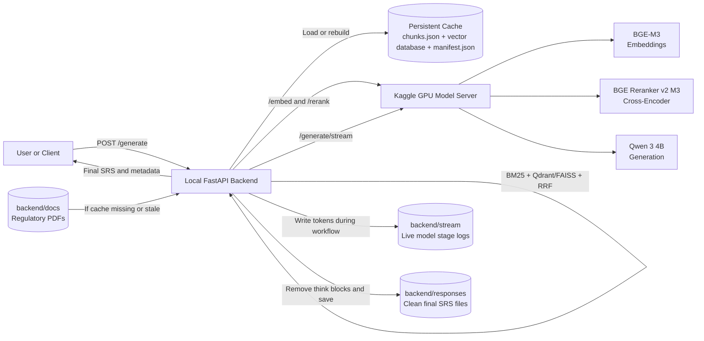
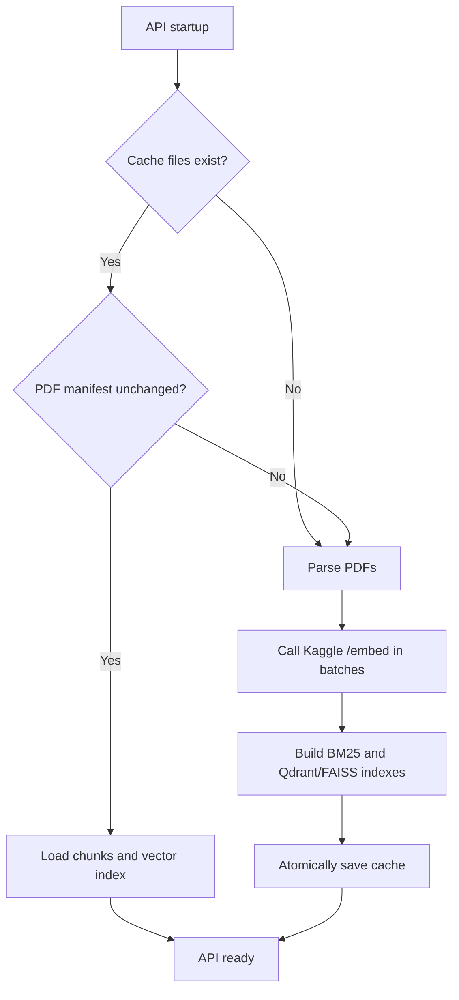
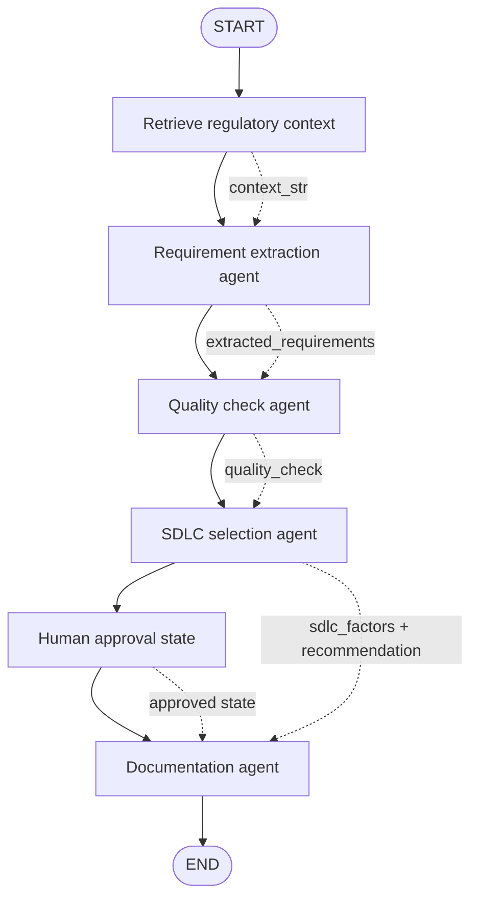

# Regulatory Requirements Engineering System

## 1. Project Overview

This project converts a short software requirement into a structured Software Requirements Specification (SRS) for regulated FinTech and Account Aggregator systems.

The system combines:

- Regulatory PDF retrieval
- Hybrid search using BM25 and a configurable Qdrant or FAISS vector index
- BGE-M3 semantic embeddings
- BGE cross-encoder reranking
- Qwen 3 4B generation
- LangGraph workflow orchestration
- Persistent document caching and Qdrant or FAISS vector storage
- File-based streaming of intermediate model output
- Structured SRS generation with citations and SDLC recommendations

The design separates lightweight orchestration from GPU model inference:

- The local machine runs the API, PDF parsing, BM25, vector retrieval, and LangGraph orchestration.
- Kaggle runs Qwen, BGE-M3, and the BGE reranker behind HTTP APIs.

---

## 2. High-Level Architecture



### Responsibility split

| Area | Local backend | Kaggle server |
|---|---|---|
| HTTP orchestration | Yes | Yes, for model APIs |
| PDF extraction | Yes | No |
| Chunk storage | Yes | No |
| BM25 search | Yes | No |
| Vector index | Yes, Qdrant or FAISS | No |
| Embedding model | No | BGE-M3 |
| Reranking model | No | BGE-Reranker-v2-M3 |
| Text generation | No | Qwen 3 4B |
| Final SRS assembly | Yes | No |
| Persistent response files | Yes | No |

---

## 3. Technology Stack

### Local application stack

| Layer | Technology | Purpose |
|---|---|---|
| API framework | FastAPI | Exposes health, ingestion, and generation APIs |
| ASGI server | Uvicorn | Runs the local FastAPI application |
| Configuration | Pydantic Settings | Loads `RAG_` environment variables |
| HTTP client | Requests | Calls Kaggle model APIs |
| PDF parser | pypdf | Extracts text without local ML inference |
| Sparse retrieval | rank-bm25 | Keyword-based document retrieval |
| Dense retrieval | Qdrant by default, FAISS fallback | Similarity search over normalized embeddings |
| Numerical processing | NumPy | Embedding arrays and ranking operations |
| Workflow engine | LangGraph | Connects the requirement engineering stages |
| Runtime language | Python 3.13 | Application implementation |

### Kaggle model stack

| Model or component | Type | Location | Purpose |
|---|---|---|---|
| Qwen 3 4B | Causal language model | Kaggle model path | Requirement analysis and generation |
| BAAI/bge-m3 | Embedding model | Kaggle GPU/CPU runtime | Converts chunks and queries into vectors |
| BAAI/bge-reranker-v2-m3 | Cross-encoder reranker | Kaggle GPU/CPU runtime | Scores query-document relevance |
| BitsAndBytes | 8-bit quantization | Kaggle runtime | Reduces Qwen memory usage |
| TextIteratorStreamer | Token streamer | Kaggle runtime | Produces generation tokens incrementally |
| pyngrok | Tunnel client | Kaggle runtime | Exposes Kaggle APIs to the local backend |

Qwen is loaded from the attached Kaggle dataset. The embedding and reranking models are loaded by the Kaggle runtime using their model identifiers.

---

## 4. Document Ingestion

Source documents are placed in:

```text
backend/docs/*.pdf
```

The ingestion implementation is in [backend/rag/ingest.py](backend/rag/ingest.py).

### Ingestion process

1. Find all PDF files in `backend/docs`.
2. Read each PDF page with `pypdf`.
3. Extract page text.
4. Split page text into approximately 1,800-character chunks.
5. Preserve document name and page number as metadata.
6. Return chunks in the common structure:

```json
{
  "text": "Extracted regulatory text",
  "meta": {
    "doc": "Readable document title",
    "section": "Page 12"
  }
}
```

The metadata is later included in retrieval context and citations.

### Parser tradeoff

The current parser is intentionally lightweight. It extracts text reliably from text-based PDFs but does not perform OCR or complex layout reconstruction. Scanned PDFs may need a future OCR stage.

---

## 5. Persistent Cache and Vector Database

The persistent cache is stored here:

```text
backend/data/
├── chunks.json
├── index.faiss                 # used only with RAG_VECTOR_DB_BACKEND=faiss
├── qdrant/                     # used by the default local Qdrant backend
└── manifest.json
```

### Cache files

- `chunks.json`: Parsed text chunks and source metadata.
- `index.faiss`: Normalized dense embedding index when the FAISS fallback is selected.
- `qdrant/`: Persistent local Qdrant storage when using the default backend.
- `manifest.json`: PDF names, sizes, and modification timestamps.

### Startup behavior



The cache is invalidated when a PDF is added, deleted, resized, or modified. A normal `POST /ingest` is cache-aware. To explicitly rebuild:

```text
POST /ingest?force=true
```

Cache writes use temporary files followed by replacement, which prevents a reloader or second process from seeing partially written cache files.

---

## 6. Retrieval Pipeline

The retrieval implementation is in [backend/rag/vector_store.py](backend/rag/vector_store.py).

### Retrieval stages

1. **BM25 retrieval**
   - Tokenizes the query and chunk text using lowercase whitespace splitting.
   - Finds keyword-relevant chunks.

2. **Dense retrieval**
   - Sends the query to Kaggle `/embed`.
   - Normalizes the query vector.
   - Searches Qdrant by default, or the local FAISS inner-product index when configured as fallback.
   - Because vectors are normalized, inner product behaves as cosine similarity.

3. **Reciprocal Rank Fusion**
   - Combines BM25 and dense-vector rankings.
   - Uses the standard RRF scoring form:

   $$
   RRF(d) = \sum_{r \in \text{rankings}} \frac{1}{60 + rank_r(d) + 1}
   $$

4. **Cross-encoder reranking**
   - Sends the fused candidates and query to Kaggle `/rerank`.
   - Sorts candidates by the returned cross-encoder scores.
   - Returns the final top five chunks by default.

### Retrieval defaults

```text
Top fusion candidates: 20
Final retrieved chunks: 5
Embedding batch size: 8
```

These values are configurable through the `RAG_` environment prefix.

---

## 7. Kaggle Model APIs

The Kaggle implementation is in [backend/kaggle_server.py](backend/kaggle_server.py).

| Endpoint | Purpose | Response |
|---|---|---|
| `GET /health` | Runtime health check | `{"status": "ok"}` |
| `POST /embed` | Embed one or more texts | `{"embeddings": [...]}` |
| `POST /rerank` | Score documents for a query | `{"scores": [...]}` |
| `POST /generate` | Buffered generation | `{"status": "success", "response": "..."}` |
| `POST /generate/stream` | Token-by-token generation | `text/plain` stream |

The local backend uses `/embed`, `/rerank`, and `/generate/stream` for the full pipeline. The buffered `/generate` endpoint remains available for compatibility and direct testing.

### Generation configuration

- Default maximum output: 1,024 tokens.
- Temperature: `0.3` by default.
- Top-p: `0.95` by default.
- Repetition penalty: `1.05`.
- Qwen uses a system message describing the FinTech compliance role.
- Qwen is loaded with 8-bit quantization and `device_map="auto"`.

The ngrok token must be supplied through the Kaggle Secret/environment variable:

```text
NGROK_AUTHTOKEN
```

It should never be committed to source code.

---

## 8. LangGraph Workflow

The workflow is implemented in [backend/graph/workflow.py](backend/graph/workflow.py). Its shared state is defined in [backend/state.py](backend/state.py).

### State fields

| State field | Meaning |
|---|---|
| `user_query` | Original minimal requirement |
| `organization_scale` | Small, Medium, Enterprise, or other requested scale |
| `use_rag` | Whether regulatory retrieval is enabled |
| `generation_options` | Qwen generation parameters |
| `retrieved_context` | Selected chunks with metadata |
| `context_str` | Citation-ready context string |
| `extracted_requirements` | Structured requirement records |
| `quality_check` | Ambiguity and completeness result |
| `sdlc_factors` | Risk and project factor assessment |
| `sdlc_recommendation` | Ranked SDLC options and workflow phases |
| `human_approved` | Approval state passed through the workflow |
| `final_srs_markdown` | Final assembled SRS |

### Graph connection diagram



### Node responsibilities

#### 1. Retrieve

Uses the hybrid vector store to retrieve relevant regulatory chunks. It formats each result with a document name and page location.

#### 2. Requirement extraction

Calls Qwen through the Kaggle streaming endpoint and asks for structured requirement JSON, including:

- Requirement ID
- Title
- Description
- Category
- MoSCoW priority
- Citation
- Gherkin-style acceptance criteria

If the model response is not valid JSON, the agent returns a safe fallback requirement record.

#### 3. Quality check

Reviews the original request and extracted requirements for:

- Ambiguity
- Missing security controls
- Missing consent controls
- Missing privacy or retention requirements
- Missing operational concerns

#### 4. SDLC selection

Evaluates options such as DevSecOps, Agile-V-Model Hybrid, V-Model, Spiral, and Waterfall. It returns risk factors, ranked scores, a primary recommendation, and custom workflow phases.

#### 5. Human approval

Preserves the approval flag in the state. The current API request supplies the flag, defaulting to approved for automated testing. This node is the extension point for a future interactive approval or persistence mechanism.

#### 6. Documentation

Assembles the extracted requirements, quality findings, SDLC recommendation, citations, and workflow phases into final Markdown SRS output.

### Important workflow property

The workflow streams each model stage to a file, but it still waits for the complete response from each agent before advancing. This is required because the next agent depends on the previous agent's complete structured output.

---

## 9. Single Local Response API

The main local response endpoint is:

```text
POST /generate
```

It runs the entire RAG and LangGraph pipeline.

### Request example

```json
{
  "minimal_requirement": "Users should link savings accounts and fetch financial statements using PAN and DOB with consent management.",
  "scale": "Medium",
  "use_rag": true,
  "human_approved": true,
  "max_new_tokens": 1024,
  "temperature": 0.3,
  "top_p": 0.95
}
```

### Response contents

The response contains:

- Final SRS Markdown
- Retrieved source metadata
- Extracted requirements
- Quality check result
- SDLC factors
- SDLC recommendation
- Human approval state
- Stream log path
- Clean response path

Other local endpoints:

| Endpoint | Purpose |
|---|---|
| `GET /health` | Check local API availability |
| `POST /ingest` | Load cache or rebuild if documents changed |
| `POST /ingest?force=true` | Force cache rebuild |

---

## 10. Streaming and Output Files

The streaming helper is [backend/stream/capture.py](backend/stream/capture.py).

### Live stage log

Each request creates a numbered log:

```text
backend/stream/stream_001.log
backend/stream/stream_002.log
```

The file is written and flushed as tokens arrive. It includes stage separators such as:

```text
--- MODEL STAGE 1 ---
--- MODEL STAGE 2 ---
--- MODEL STAGE 3 ---
```

### Clean final response

After the workflow completes, the final SRS is cleaned and saved as:

```text
backend/responses/response_001.md
backend/responses/response_002.md
```

The cleaner removes reasoning sections matching:

```text
<think>...</think>
```

The response endpoint returns both paths so a caller can locate the live stream log and final artifact.

---

## 11. Directory Structure

```text
SE_Proj1/
├── PROJECT_DOCUMENTATION.md
├── backend/
│   ├── api/
│   │   └── main.py
│   ├── agents/
│   │   ├── base.py
│   │   ├── documentation.py
│   │   ├── quality.py
│   │   ├── requirement.py
│   │   └── sdlc.py
│   ├── data/
│   │   ├── chunks.json
│   │   ├── index.faiss
│   │   └── manifest.json
│   ├── docs/
│   │   └── regulatory PDFs
│   ├── graph/
│   │   └── workflow.py
│   ├── rag/
│   │   ├── cache.py
│   │   ├── ingest.py
│   │   ├── pipeline.py
│   │   └── vector_store.py
│   ├── responses/
│   │   └── response_*.md
│   ├── stream/
│   │   ├── __init__.py
│   │   ├── capture.py
│   │   └── stream_*.log
│   ├── config.py
│   ├── kaggle_server.py
│   ├── model_client.py
│   ├── requirements.txt
│   ├── schemas.py
│   ├── state.py
│   ├── test_e2e.py
│   ├── test_full_pipeline.py
│   ├── test_full_pipeline_stream.py
│   └── test_stream.py
└── software-engineering-2.ipynb
```

The `data`, `responses`, and `stream` directories are runtime data locations and should normally be excluded from source control if they contain generated artifacts.

---

## 12. Running the System

### Start Kaggle model server

Run the Kaggle server with the GPU dependencies installed and `NGROK_AUTHTOKEN` configured as a Kaggle Secret. Copy the printed public base URL into the local `.env` file:

```env
RAG_KAGGLE_URL=https://your-current-ngrok-domain
```

### Start the local API

```powershell
cd D:\SE_Proj1\backend
.\venv\Scripts\python.exe -m uvicorn api.main:app --reload
```

### Run the full test

```powershell
cd D:\SE_Proj1\backend
.\venv\Scripts\python.exe test_full_pipeline_stream.py
```

This checks the local API, uses the persistent document cache, executes the complete RAG and LangGraph workflow, streams model stages to a file, and saves the final SRS.

### Direct streaming test

```powershell
.\venv\Scripts\python.exe test_stream.py
```

This bypasses RAG and directly tests Kaggle generation streaming.

---

## 13. Operational Notes and Future Improvements

- The free ngrok URL is temporary and may change when the Kaggle session restarts.
- The local `.env` must be updated when the Kaggle URL changes.
- Kaggle model inference can be slow, especially for long prompts and multiple workflow stages.
- The local client uses a long response timeout because generation is streamed and GPU inference may take time.
- The current `human_approved` node is state-preserving rather than a real interactive pause.
- OCR can be added later for scanned PDFs.
- A production deployment should replace temporary ngrok with a stable authenticated service or reserved domain.
- Authentication, authorization, rate limiting, request tracing, and secret management should be added before exposing the local API publicly.
- The model JSON parser has fallbacks, but production use should also validate agent outputs against formal Pydantic schemas.
