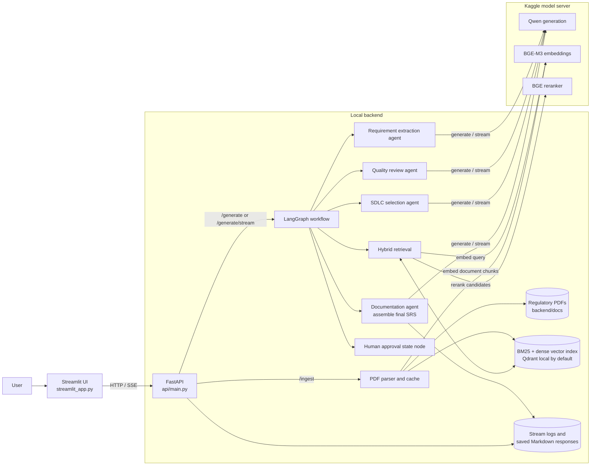
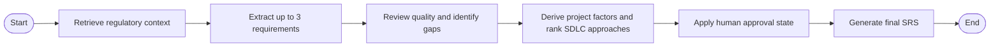

# Account Aggregator Requirements Assistant

## What this project does

This is an **Account Aggregator (AA) product requirements assistant** for teams designing financial products that connect to India's AA ecosystem. Give it a minimal feature idea, and it expands that idea into a structured Software Requirements Specification (SRS), with requirements, acceptance criteria, regulatory evidence, quality gaps, and a suggested software development lifecycle (SDLC).

The target use cases include products that need customers to discover and link financial accounts, grant or revoke consent, and share financial information with an authorized Financial Information User (FIU). Examples include a lending or personal finance app that needs customer-authorized bank data. The output can also help teams working on AA, Financial Information Provider (FIP), or FIU integrations turn an early product idea into implementation-ready requirements.

In the AA ecosystem, the customer authorizes sharing; the AA manages the consent and data-sharing flow; FIPs hold the financial information; and FIUs receive it for the purpose the customer approved. The reference material covers account discovery and linking, consent artefacts and their lifecycle, financial information requests and notifications, interoperable API contracts and FI type schemas, customer-friendly consent experiences, and RBI governance and operational obligations. The system retrieves relevant material from these sources to ground requirements and citations.

The workflow uses **domain-specialized agents** for requirement extraction, quality review, SDLC selection, and SRS writing. They share a Qwen 3 4B model and use role-specific prompts; retrieved regulatory and technical documents provide additional AA domain grounding. The model's specialization comes from the agent prompts and retrieval-augmented generation (RAG).

The result is a starting specification for product, engineering, and compliance review. It is not a substitute for validating regulatory interpretation with the responsible compliance and legal teams.

### Knowledge base

The PDFs in `backend/docs` provide the domain context for generation:

- **RBI:** NBFC-AA Directions (2025), the earlier 2016 Master Direction, and the SRO-AA recognition framework. The 2016 document is historical; check the applicable current directions when validating generated requirements.
- **ReBIT:** AA API Specification v2.0.0, PAN and date-of-birth account discovery guidance, mandatory and optional FI schema fields, and Deposit/RD/TD FI Type Schema v2.0.0 adoption guidance.
- **Sahamati:** Customer-friendly AA consent-flow design guidelines, including customer understanding, account sharing, and consent revocation.
- **MeitY:** Electronic Consent Framework technology specifications v1.1.
- **IEEE:** IEEE 830-1998 recommended SRS outline and requirements-writing guidance.

Together, these references ground AA lifecycle and integration requirements as well as the shape and quality of the resulting SRS. Regulatory applicability and document versions still need review for each product and release.

## Architecture

A FastAPI service coordinates document retrieval and a LangGraph workflow; model inference, embeddings, and reranking run on the remote Kaggle model server. A Streamlit app provides the user interface.



### LangGraph generation flow

Each request runs through a compiled, sequential `StateGraph`. Its shared state carries the original request, retrieved evidence, intermediate analysis, and final Markdown.



When `use_rag` is false, the retrieve step supplies empty context and the remaining steps still run. The approval node currently carries the request's `human_approved` boolean into the result; it does not pause execution for a person or gate the documentation step.

### Components

- **API and UI:** FastAPI validates requests, exposes generation and document endpoints, and streams generation events as server-sent events (SSE). Streamlit calls these endpoints and displays results, source metadata, progress, and streamed model output.
- **Document ingestion:** `pypdf` extracts text from PDFs in `backend/docs`, splits page text into chunks, and stores document/page metadata. Startup loads the persisted cache when it is current, otherwise it parses and indexes the PDFs. `POST /ingest?force=true` forces a rebuild. The current cache freshness check also requires `index.faiss`; with the default Qdrant backend, a fresh cache may therefore be rebuilt on startup if that file is absent.
- **Retrieval:** The hybrid store combines BM25 keyword ranking and dense embedding search with reciprocal-rank fusion, then uses the remote reranker to select the final context chunks. Defaults are 20 fusion candidates and 5 final chunks.
- **Workflow agents:** Requirement extraction returns structured requirements; quality review reports ambiguity and missing details; SDLC selection derives project factors and ranks approaches; documentation generates the final SRS from the analysis and retrieved context. If generated SRS text is unavailable, the documentation agent can assemble a fallback document.
- **Model service:** `RemoteModelClient` calls the Kaggle server for `/embed`, `/rerank`, `/generate`, and `/generate/stream`. Model traffic stays remote; the local service handles API orchestration, PDF parsing, retrieval, and persistence.
- **Persistence:** The default vector backend is local Qdrant at `backend/data/qdrant`. Chunk data and the PDF manifest are stored under `backend/data`; streamed stage output goes to `backend/stream`, and final Markdown goes to `backend/responses`.

## Requirements

- Python 3.10 or newer
- A running Kaggle model server implementing the endpoints above
- Regulatory PDF files placed in `backend/docs` (create this directory if needed)

## Configure the Kaggle model server

In a Kaggle notebook, first install the model server dependencies:

```python
!pip install fastapi uvicorn pyngrok nest-asyncio transformers bitsandbytes torch accelerate sentence-transformers -q
```

Then add the contents of [`backend/kaggle.py`](kaggle.py) to a notebook code cell and run it. This script loads the Qwen 3 4B model plus the BGE-M3 embedding and BGE reranker models, starts the FastAPI model server, and exposes `/health`, `/embed`, `/rerank`, `/generate`, and `/generate/stream` through ngrok. Make sure the Qwen model is attached to the Kaggle notebook at the path configured in the script (`/kaggle/input/models/qwen-lm/qwen-3/transformers/4b/1`).

Before running the script, add a Kaggle Secret named `NGROK_AUTH_TOKEN`; the script reads this exact secret name. Copy the printed API URL into `RAG_KAGGLE_URL` in `backend/.env`. Keep the Kaggle notebook running while using the local backend.

## Run locally

From the `backend` directory, create `.env` from `.env.example`, set the Kaggle URL, and install dependencies:

```powershell
Copy-Item .env.example .env
python -m pip install -r requirements.txt
```

Start FastAPI in one terminal:

```powershell
python -m uvicorn api.main:app --reload
```

Start Streamlit in another terminal:

```powershell
python -m streamlit run streamlit_app.py
```

Open the local Streamlit URL printed by the command (usually `http://localhost:8501`). The API starts on `http://127.0.0.1:8000`. At API startup, the backend loads the current PDF index or rebuilds it if the cache is absent or stale. You can also use **Ingest PDFs** in the UI or call `POST /ingest`.

## API overview

| Method and path | Purpose |
| --- | --- |
| `GET /health` | Check that the API is responding. |
| `GET /documents` | List PDFs available in the configured documents directory. |
| `GET /documents/{filename}` | Read a PDF from that directory. |
| `POST /ingest` | Load or rebuild the document index. Add `?force=true` to force rebuilding. |
| `POST /generate` | Run the workflow and return the completed response as JSON. |
| `POST /generate/stream` | Stream progress and model tokens as SSE, followed by the complete workflow result. |
| `GET /responses` | List saved SRS Markdown files. |
| `GET /responses/{filename}` | Read a saved SRS. |

Example request body for either generation route:

```json
{
  "minimal_requirement": "Users can link savings accounts and fetch statements using PAN and DOB.",
  "scale": "Medium",
  "use_rag": true,
  "human_approved": false,
  "max_new_tokens": 2048,
  "temperature": 0.3,
  "top_p": 0.95
}
```

The completed response includes the SRS Markdown, retrieved source metadata, extracted requirements, quality review, SDLC factors and recommendation, approval state, and paths to the stream and response files.

## Configuration

Settings use the `RAG_` prefix and can be set in `.env` or the environment. Common options:

| Variable | Default | Purpose |
| --- | --- | --- |
| `RAG_KAGGLE_URL` | Set in `.env.example` | Base URL for the remote model server. |
| `RAG_DATA_DIR` | `backend/docs` | Source PDF directory. |
| `RAG_CACHE_DIR` | `backend/data` | Chunk manifest and persisted index data. |
| `RAG_VECTOR_DB_BACKEND` | `qdrant` | `qdrant` or `faiss`. |
| `RAG_VECTOR_DB_PATH` | `backend/data/qdrant` | Local Qdrant storage path. |
| `RAG_VECTOR_DB_URL` / `RAG_VECTOR_DB_API_KEY` | unset | Optional remote Qdrant connection. |
| `RAG_TOP_K_FUSION` | `20` | Candidate count before reranking. |
| `RAG_FINAL_K` | `5` | Number of context chunks passed to the workflow. |
| `RAG_STREAM_DIR` | `backend/stream` | Per-run model stream logs. |
| `RAG_RESPONSE_DIR` | `backend/responses` | Generated SRS files. |

See `config.py` for all supported settings. The local machine needs no GPU; generation, embeddings, and reranking are performed by the configured Kaggle server.
